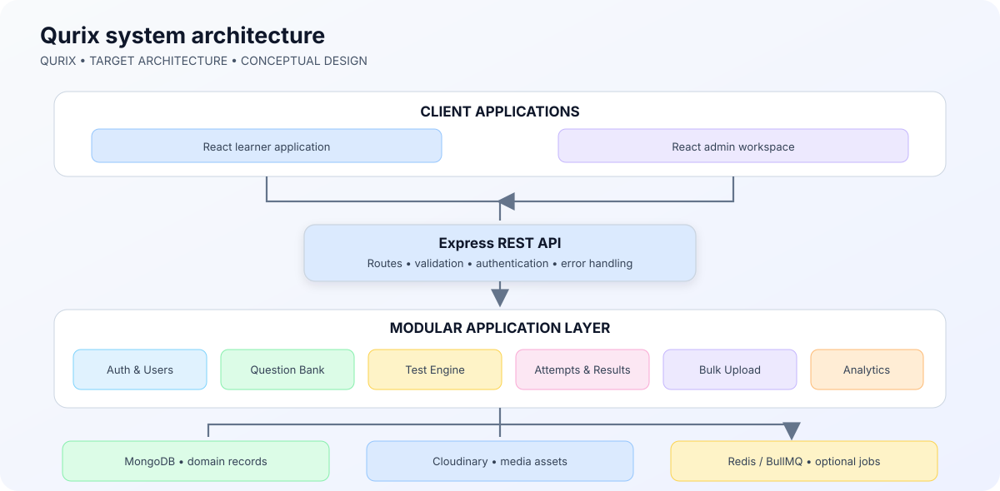
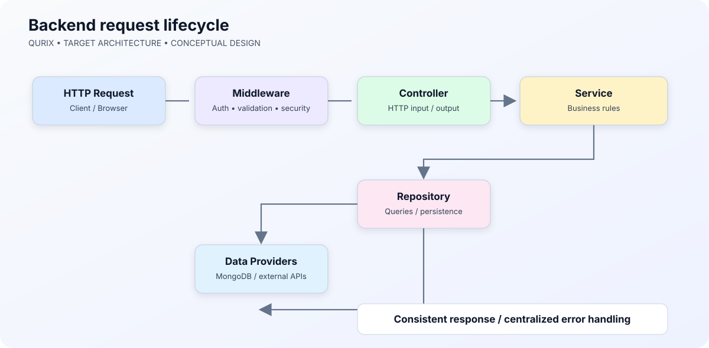
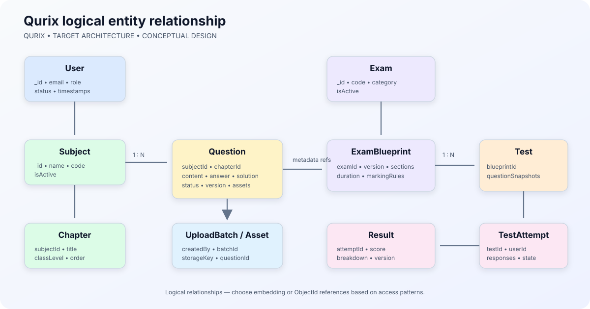
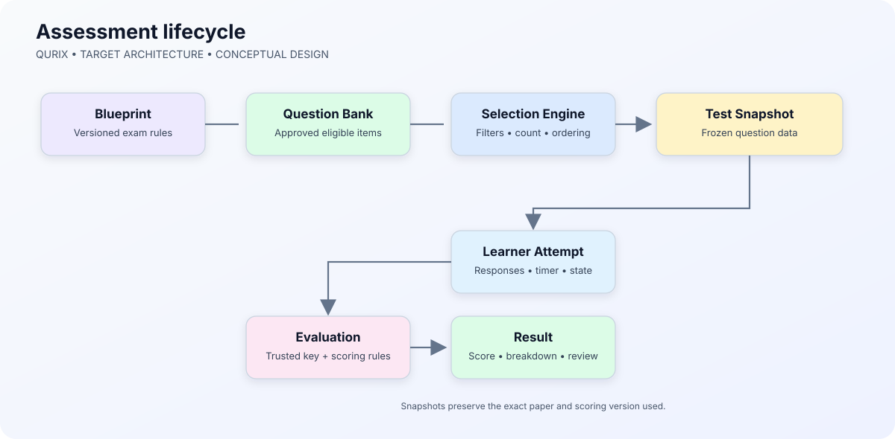
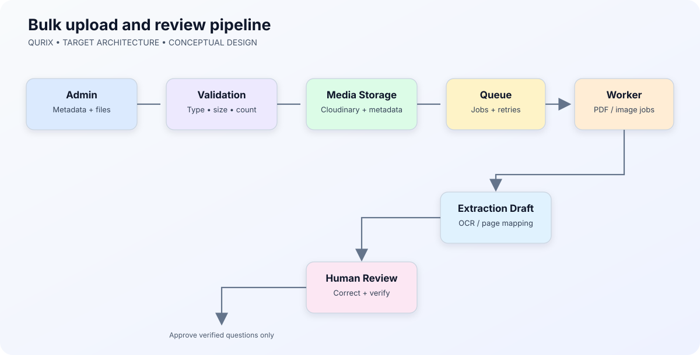

# Qurix

<strong>A structured question bank and assessment platform for senior-secondary and competitive-exam learners.</strong>

  
  
  
  
  

  <a href="#project-overview">Overview</a> · <a href="#architecture">Architecture</a> · <a href="#data-model">Data model</a> · <a href="#repository-structure">Structure</a> · <a href="#roadmap">Roadmap</a>

---

## Contents
- [Project overview](#project-overview)
- [Product scope](#product-scope)
- [Technology stack](#technology-stack)
- [Architecture](#architecture)
- [Data model](#data-model)
- [Question content and assets](#question-content-and-assets)
- [Test generation and evaluation](#test-generation-and-evaluation)
- [Bulk upload pipeline](#bulk-upload-pipeline)
- [Repository structure](#repository-structure)
- [API design](#api-design)
- [Security](#security)
- [Environment configuration](#environment-configuration)
- [Local development](#local-development)
- [Testing](#testing)
- [Deployment](#deployment)
- [Roadmap](#roadmap)
- [Engineering decisions](#engineering-decisions)

---

## Project overview

**Qurix** is a full-stack educational question-bank and assessment platform for Class 11–12 students and competitive-examination aspirants.

Learners can discover verified questions, create focused practice sessions, attempt timed tests, review detailed solutions and understand their performance. Administrators curate the question bank and control which content becomes available.

Qurix is designed around a configurable assessment engine. Examination rules belong in versioned, data-driven blueprints—not hardcoded throughout controllers or test-generation logic.

### Product principles

1. **Verified content first:** questions, answer keys, marks and solutions are supplied and reviewed by authorized content managers.
2. **Configurable examinations:** formats, durations and marking rules are represented by versioned blueprints.
3. **Media-aware learning:** one question can combine text, LaTeX, diagrams and multiple images.
4. **Reproducible attempts:** generated tests retain snapshots of the questions and scoring configuration used at generation time.
5. **Separation of concerns:** HTTP controllers, business services, persistence, file processing and background jobs remain separate.
6. **Incremental engineering:** this document describes the target architecture. Implement only the modules required by the current milestone.

> **Project status:** This README documents the intended product and target architecture. A module or folder appearing here does not mean its business logic is already implemented. The source code and tests are authoritative for implementation status.

## Product scope

### Learners
- Browse questions by board, exam, class, subject and chapter.
- Filter by question type, difficulty, language and marks.
- Create focused practice sessions or configured mock tests.
- Attempt objective and numerical questions.
- Review submitted answers, marks and explanations.
- View attempt history and topic-level performance.

### Administrators and reviewers
- Manage subjects, chapters and examination metadata.
- Upload multiple question images and PDFs in batches.
- Add text, LaTeX, options, answer keys and detailed solutions.
- Map assets to questions and control display order.
- Review extracted or manually entered content.
- Approve, reject, archive and revise questions.
- Maintain examination blueprints and marking schemes.

### Initial academic scope

| Category | Initial support | Expansion |
|---|---|---|
| Board | WBCHSE | CBSE and other state boards |
| Competitive exams | JEE Main, JEE Advanced, WBJEE, NEET UG | Additional exams as content becomes available |
| Class | 11 and 12 | Future classes |
| Subjects | Physics, Chemistry, Mathematics, Biology | Subject-specific extensions |
| Languages | English and Bengali | Additional languages later |

### Question formats

| Type | Typical answer | Evaluation |
|---|---|---|
| Single correct | One option | Exact option match |
| Multiple correct | One or more options | Blueprint-defined rule |
| Numerical | Numeric value | Exact or tolerance-based comparison |
| Integer | Integer value | Exact match |
| True / False | Boolean | Exact match |
| Subjective | Written response | Manual evaluation; future scope |

The list above is a product target. The active implementation must validate only the formats it actually supports.

## Technology stack

| Layer | Technology | Responsibility |
|---|---|---|
| Web client | React | Learner and admin interfaces |
| Frontend tooling | Vite | Development and production build |
| Styling | Tailwind CSS | Responsive UI styling |
| API server | Node.js + Express | HTTP API and orchestration |
| Database | MongoDB | Domain and assessment data |
| ODM | Mongoose | Schema validation, models and references |
| Media storage | Cloudinary | Question and solution images |
| Formula rendering | KaTeX | Mathematical notation |
| Authentication | JWT-based flow | Authenticated API access |
| Password security | bcrypt | Password hashing |
| Validation | Zod (planned convention) | API input validation |
| Upload handling | Multer / signed uploads | Multipart or direct media upload |
| Image processing | Sharp | Image normalization |
| PDF processing | pdfjs-dist | PDF page extraction |
| Background processing | BullMQ + Redis (optional) | Long-running upload jobs |
| API documentation | OpenAPI / Swagger | API contract |
| Testing | Vitest or Jest + Supertest | Unit and HTTP integration tests |
| Logging | Pino | Structured logs |
| Security | Helmet, CORS, rate limiting | HTTP and abuse protections |

**Dependency rule:** keep the first deployment simple. Redis, BullMQ, OCR and other infrastructure should be introduced when workload and reliability requirements justify them.

## Architecture

Qurix is intended to start as a **modular monolith**: one API application with clearly separated business modules. This keeps deployment manageable for a small team without sacrificing internal boundaries.

### Main layers

| Layer | Responsibility | Avoid |
|---|---|---|
| Client | Pages, components, forms, state and API calls | Database queries or secrets |
| Routes | URL mapping and middleware composition | Business workflows |
| Controllers | Translate HTTP input/output | Large database workflows |
| Services | Business rules and use-case orchestration | Express request/response objects |
| Repositories | Reusable persistence queries | HTTP response formatting |
| Models | Persistence schema and document constraints | Application orchestration |
| Infrastructure services | Cloudinary, email, cache and integrations | Feature-specific workflows |
| Jobs / workers | Long-running asynchronous processing | Normal HTTP request lifecycle |

### Backend request lifecycle

1. Client sends an HTTP request.
2. Express applies request ID, security, CORS and parsing middleware.
3. Authentication and authorization run when required.
4. Validation checks params, query and body.
5. The route invokes a controller.
6. The controller calls a service with validated input and user context.
7. The service applies business rules and calls repositories or infrastructure services.
8. The controller returns a consistent response.
9. Central error middleware handles unexpected failures.

Controllers should remain thin. Do not mix question selection, score calculation, Cloudinary operations and database writes inside one controller.

## Data model

MongoDB documents should represent the domain deliberately. Use references for independently managed entities and embed small, bounded data that is normally read or written together.

### Relationship overview

| Parent | Relationship | Child / reference | Reason |
|---|---|---|---|
| Subject | One-to-many | Chapter | Chapters are independently browsable |
| Chapter | One-to-many | Question | Questions are filtered by chapter |
| Question | Many-to-many metadata | Exam / Board | A question may apply to multiple categories |
| User | One-to-many | TestAttempt | Attempt history belongs to a learner |
| Exam | One-to-many | ExamBlueprint | Blueprint versions must be preserved |
| ExamBlueprint | One-to-many | Test | Tests use a defined pattern |
| Test | One-to-many | TestAttempt | Multiple learners can attempt a test |
| TestAttempt | One-to-one | Result summary | A submitted attempt produces a score summary |
| UploadBatch | One-to-many | UploadAsset | A batch groups files and processing state |
| UploadAsset | Optional relation | Question | An asset can be mapped after review |

These are logical relationships. Mongoose can represent them with ObjectId references, embedded subdocuments or a combination. Do not create a collection for every nested field.

### Core modelling rules

- Reference independently managed records such as users, subjects, chapters, exams and blueprints.
- Use timestamps consistently.
- Validate controlled fields such as role, status and question type.
- Keep arrays bounded. Do not store unbounded attempt histories inside User.
- Store media metadata and provider identifiers, not large binary files, in MongoDB.
- Archive curated content where historical tests may still reference it.
- Add unique indexes only for genuine uniqueness constraints.
- Snapshot question content and scoring configuration in generated tests.
- Never expose answer keys in learner-facing question responses before submission.

### Core model catalogue

| Model | Key fields | Purpose |
|---|---|---|
| User | name, email, passwordHash, role, status | Identity and access |
| Subject | name, slug, code, isActive | Subject catalogue |
| Chapter | subjectId, title, slug, order, classLevel | Chapter hierarchy |
| Exam | name, code, category, isActive | Exam catalogue |
| ExamBlueprint | examId, version, sections, duration, markingRules, status | Versioned exam rules |
| Question | subjectId, chapterId, type, difficulty, content, answer, solution, status | Curated question |
| Test | ownerId, blueprintVersion, filters, questionSnapshots, status | Generated test |
| TestAttempt | testId, userId, startedAt, submittedAt, responses, state | One learner's attempt |
| Result | attemptId, score, counts, breakdown, scoringVersion | Evaluated summary |
| UploadBatch | createdBy, commonMetadata, status, counters | Bulk upload job |
| UploadAsset | batchId, storageKey, assetType, order, processingStatus, questionId | Source file or page |
| AuditLog | actorId, action, resourceType, resourceId, metadata | Administrative history |

### Question model: conceptual shape

<pre><code>{
  _id: ObjectId,
  subjectId: ObjectId,
  chapterId: ObjectId,
  academic: {
    classLevel: 12,
    boards: ["WBCHSE"],
    exams: ["JEE_MAIN", "WBJEE"]
  },
  type: "SINGLE_CORRECT",
  difficulty: "HARD",
  language: "EN",
  content: {
    text: "Find the value of the expression.",
    latex: "\\int_0^1 x^2 \\, dx",
    assets: [
      { assetId: ObjectId, role: "QUESTION_IMAGE", order: 0 }
    ]
  },
  options: [
    { key: "A", content: { text: "Option A", latex: "" } },
    { key: "B", content: { text: "Option B", latex: "" } }
  ],
  answer: { type: "OPTION", value: ["A"], tolerance: null },
  solution: { text: "Step-by-step explanation.", latex: "", assets: [] },
  marks: { positive: 4, negative: 1 },
  status: "PENDING_REVIEW",
  version: 1,
  createdBy: ObjectId,
  reviewedBy: null,
  reviewedAt: null
}</code></pre>

**Question modelling notes**
- The answer shape must be validated according to question type.
- Multiple-correct evaluation must follow an explicit scoring policy.
- Numerical questions may need tolerance, units and normalization rules.
- Keep answer keys out of public question serialization.
- Question revisions must not rewrite snapshots already used by tests.

### Exam blueprint: conceptual shape

<pre><code>{
  examId: ObjectId,
  version: 2,
  status: "PUBLISHED",
  durationSeconds: 10800,
  sections: [{
    key: "MATHEMATICS",
    title: "Mathematics",
    questionCount: 20,
    selectionRules: {
      subjects: ["MATHEMATICS"],
      chapters: [],
      difficulties: ["EASY", "MEDIUM", "HARD"],
      questionTypes: ["SINGLE_CORRECT", "NUMERICAL"]
    },
    markingRuleId: "JEE_MAIN_MATH_V2"
  }],
  instructions: {
    language: ["EN", "BN"],
    shuffleQuestions: true,
    shuffleOptions: true
  },
  publishedAt: Date,
  createdBy: ObjectId
}</code></pre>

A blueprint describes an exam pattern, not a learner's attempt. Publish a new version when rules change; do not silently mutate the pattern used by existing tests.

### Test snapshots

A generated test should preserve the exact question order and content needed for historical review.

<pre><code>{
  createdBy: ObjectId,
  blueprintId: ObjectId,
  blueprintVersion: 2,
  configuration: {
    examCode: "JEE_MAIN",
    subjectCodes: ["MATHEMATICS"],
    chapterIds: [],
    questionCount: 20,
    difficulty: "MIXED",
    language: "EN"
  },
  questionSnapshots: [{
    questionId: ObjectId,
    questionVersion: 3,
    position: 1,
    type: "SINGLE_CORRECT",
    contentSnapshot: {},
    optionsSnapshot: [],
    answerSnapshot: {},
    marksSnapshot: {}
  }],
  durationSeconds: 3600,
  status: "PUBLISHED"
}</code></pre>

The answer snapshot is server-only. Never return it in the test-taking payload. It exists to support trusted evaluation and reproducible review.

### TestAttempt and Result

A TestAttempt owns one learner's answers and attempt lifecycle.

<pre><code>{
  testId: ObjectId,
  userId: ObjectId,
  state: "IN_PROGRESS",
  startedAt: Date,
  submittedAt: null,
  responses: [{
    questionId: ObjectId,
    selectedOptions: ["A"],
    numericalAnswer: null,
    markedForReview: false,
    answeredAt: Date
  }],
  scoringVersion: "score-engine-v1"
}</code></pre>

A Result is a derived, query-friendly summary:

<pre><code>{
  attemptId: ObjectId,
  userId: ObjectId,
  totalMarks: 80,
  obtainedMarks: 64,
  correctCount: 16,
  incorrectCount: 3,
  unansweredCount: 1,
  sectionBreakdown: [],
  evaluatedAt: Date,
  scoringVersion: "score-engine-v1"
}</code></pre>

The values above are examples only. The server calculates scores from the trusted answer snapshot and blueprint policy—not from client-submitted marks.

## Question content and assets

A question may contain text, LaTeX, diagrams, scanned images, chemistry structures, option-specific media and image-based solutions.

### Asset metadata

| Field | Meaning |
|---|---|
| provider | Storage provider, such as Cloudinary |
| publicId | Provider-side asset identifier |
| secureUrl | HTTPS delivery URL |
| resourceType | Image or raw document |
| format | File format |
| width / height | Image dimensions when available |
| bytes | File size |
| checksum | Optional duplicate detection |
| altText | Accessible description |
| ownerType / ownerId | Associated domain resource |
| role | Question, option or solution asset |
| order | Display order |

Upload strategy:
1. Validate file type, size and count on the server.
2. Generate safe storage paths and upload identifiers.
3. Upload with server credentials or a restricted signed-upload flow.
4. Persist provider identifiers and metadata.
5. Associate assets with questions after mapping is confirmed.
6. Clean up orphaned uploads with a controlled retention process.

Do not trust a browser file extension or MIME header alone. Validate actual content where practical.

## Test generation and evaluation

Test generation should be auditable and reproducible.

1. Validate exam, subject, chapters, language and difficulty.
2. Load the published blueprint version.
3. Convert blueprint rules and user filters into a selection plan.
4. Query only approved questions.
5. Check whether enough eligible questions exist in every section.
6. Select questions using a recorded strategy and random seed when reproducibility is required.
7. Snapshot selected content and marking configuration.
8. Persist the test and return a safe learner-facing representation.

### Evaluation rules

| Type | Evaluation considerations |
|---|---|
| Single correct | Exact normalized option match |
| Multiple correct | Exact set match or blueprint-defined partial credit |
| Numerical | Parsing, precision and tolerance |
| Integer | Normalization and exact match |
| True / False | Boolean normalization |
| Subjective | Manual review workflow |

Important edge cases: insufficient eligible questions, archived source questions, duplicate submissions, timeout races, numeric formatting, blueprint updates during an attempt and retried network requests. Submission must be idempotent.

## Bulk upload pipeline

Administrators should be able to upload multiple images and PDFs in one batch. Heavy extraction work must not block ordinary API requests.

### Batch metadata
- Board / examination category.
- Class level.
- Subject and chapter.
- Language.
- Source or paper reference.
- Default difficulty and marks, where applicable.
- Creating administrator.

Each file retains its own order and processing state.

### Processing states

<pre><code>CREATED → UPLOADING → UPLOADED → QUEUED
        → PROCESSING → NEEDS_REVIEW → COMPLETED

Failure: FAILED
Cancellation: CANCELLED</code></pre>

OCR and PDF extraction can misread equations, subscripts, diagrams and handwriting. Extracted content is a draft. An authorized reviewer must confirm question boundaries, options, answer keys, marks and solutions before publication.

## Repository structure

This is the intended client/server structure. Some directories may still contain placeholders while implementation progresses.

<pre><code>qurix/
├── client/                         # React + Vite application
│   ├── public/
│   └── src/
│       ├── assets/
│       ├── components/
│       │   ├── common/
│       │   ├── layout/
│       │   ├── forms/
│       │   ├── questions/
│       │   ├── tests/
│       │   └── ui/
│       ├── features/
│       │   ├── auth/
│       │   ├── questions/
│       │   ├── tests/
│       │   ├── results/
│       │   ├── analytics/
│       │   └── bulk-upload/
│       ├── pages/
│       ├── hooks/
│       ├── context/
│       ├── services/
│       ├── routes/
│       ├── utils/
│       ├── constants/
│       ├── styles/
│       ├── App.jsx
│       └── main.jsx
│
├── server/                         # Express API
│   ├── src/
│   │   ├── config/
│   │   ├── constants/
│   │   ├── database/
│   │   │   ├── indexes/
│   │   │   ├── seeds/
│   │   │   └── migrations/
│   │   ├── modules/
│   │   │   ├── auth/
│   │   │   ├── users/
│   │   │   ├── subjects/
│   │   │   ├── chapters/
│   │   │   ├── exams/
│   │   │   ├── exam-blueprints/
│   │   │   ├── questions/
│   │   │   ├── tests/
│   │   │   ├── results/
│   │   │   ├── analytics/
│   │   │   ├── bulk-upload/
│   │   │   └── admin/
│   │   ├── middleware/
│   │   ├── services/
│   │   ├── jobs/
│   │   │   ├── queues/
│   │   │   └── workers/
│   │   ├── utils/
│   │   ├── validators/
│   │   ├── routes/
│   │   ├── app.js
│   │   └── server.js
│   ├── tests/
│   │   ├── unit/
│   │   ├── integration/
│   │   ├── e2e/
│   │   └── fixtures/
│   ├── scripts/
│   ├── uploads/                    # Temporary files only
│   ├── logs/                       # Runtime logs; never commit logs
│   ├── .env.example
│   └── package.json
│
├── docs/
│   └── diagrams/
├── .gitignore
└── README.md</code></pre>

### Frontend responsibilities

| Directory | Responsibility |
|---|---|
| components | Reusable presentation and interaction components |
| features | Feature-specific UI, hooks and state |
| pages | Route-level screens |
| services | API communication |
| routes | Routing and route guards |
| context | App-wide state where appropriate |
| utils | Small pure helpers |

### Backend responsibilities

| Directory | Responsibility |
|---|---|
| config | Environment parsing and integrations |
| constants | Shared enums and stable values |
| database | Indexes, seeds and migrations |
| modules | Business features grouped by domain |
| middleware | Cross-cutting HTTP processing |
| services | Shared infrastructure integrations |
| jobs | Queue definitions and worker processors |
| utils | Small reusable helpers |
| validators | Shared validation primitives |
| routes | API route composition |

## Backend module conventions

Example module: <code>server/src/modules/questions/</code>

<pre><code>questions/
├── question.routes.js
├── question.controller.js
├── question.service.js
├── question.repository.js
├── question.model.js
├── question.validation.js
└── question.policy.js          # Optional domain permissions</code></pre>

| File | Responsibility |
|---|---|
| routes | HTTP paths and middleware order |
| controller | Translate HTTP input and output |
| service | Business rules and orchestration |
| repository | Reusable database access |
| model | Mongoose schema and indexes |
| validation | Request schemas |
| policy | Optional feature-specific authorization |

Do not add a repository, policy or abstraction merely to satisfy a template. Add it when it creates a useful boundary.

## API design

Use a versioned prefix such as <code>/api/v1</code>. Keep routes resource-oriented and response envelopes predictable.

| Method | Endpoint | Purpose | Access |
|---|---|---|---|
| POST | /api/v1/auth/register | Register | Public |
| POST | /api/v1/auth/login | Authenticate | Public |
| POST | /api/v1/auth/logout | End session | Authenticated |
| GET | /api/v1/users/me | Current profile | Authenticated |
| GET | /api/v1/subjects | List subjects | Public / authenticated |
| GET | /api/v1/chapters | Filter chapters | Public / authenticated |
| GET | /api/v1/questions | Search approved questions | Authenticated |
| POST | /api/v1/admin/questions | Create question | Admin |
| PATCH | /api/v1/admin/questions/:id/review | Review question | Reviewer |
| POST | /api/v1/tests/generate | Generate a test | Authenticated |
| POST | /api/v1/attempts/:id/submit | Submit attempt | Attempt owner |
| GET | /api/v1/attempts/:id/result | View result | Owner / admin |
| POST | /api/v1/admin/uploads | Create upload batch | Admin |
| GET | /api/v1/admin/uploads/:id | Inspect batch | Admin |

This is an API planning reference, not a claim that every endpoint already exists.

### Response convention

Success:

<pre><code>{
  "success": true,
  "message": "Question retrieved successfully",
  "data": { "id": "question-id" },
  "meta": null
}</code></pre>

Error:

<pre><code>{
  "success": false,
  "message": "Validation failed",
  "code": "VALIDATION_ERROR",
  "errors": [
    { "field": "subjectId", "message": "A valid subject is required" }
  ]
}</code></pre>

Use appropriate HTTP status codes. Never send stack traces, database errors, password hashes, tokens or secrets in public responses.

## Security

### Roles

| Role | Typical permissions |
|---|---|
| Student | Browse permitted content, generate tests and manage own attempts |
| Admin | Manage questions, uploads and routine content |
| Super admin | Manage privileged configuration and administrator access |

Enforce permissions on the server. Hiding an admin button in React is not authorization.

### Security checklist

- Hash passwords with bcrypt using a suitable work factor.
- Validate request bodies, params and query strings.
- Use secure cookie settings if authentication is cookie-based.
- Protect state-changing cookie-authenticated routes against CSRF where applicable.
- Rate-limit login, registration, upload and expensive endpoints.
- Configure CORS with explicit trusted origins.
- Use Helmet and suitable HTTP security headers.
- Enforce upload size, file-count and file-type limits.
- Keep Cloudinary, database and JWT secrets in environment variables.
- Never commit real environment files or credentials.
- Do not expose answer keys before submission.
- Check resource ownership for private attempts and results.
- Record sensitive administrative actions in an audit log.
- Make attempt submission idempotent.

## Search, indexing and performance

Indexes should follow real query patterns. Start with the filters used by the question bank and inspect query plans before adding indexes.

Illustrative index (adapt field names to the final schema):

<pre><code>questionSchema.index({
  status: 1,
  subjectId: 1,
  chapterId: 1,
  difficulty: 1
});

questionSchema.index({
  status: 1,
  "academic.exams": 1,
  type: 1
});</code></pre>

- Use pagination for question lists and admin tables.
- Prefer cursor pagination for large, frequently changing collections.
- Avoid returning full solutions and answer data in list endpoints.
- Use projections to return only required fields.
- Align indexes with filter and sort patterns.
- Monitor index size and write overhead.
- Cache stable catalogue data only when invalidation is understood.
- Never share private attempt caches across users.

## Environment configuration

Create local environment files from examples. Never commit real credentials.

### Server .env.example

<pre><code>NODE_ENV=development
PORT=5000
CLIENT_URL=http://localhost:5173

MONGODB_URI=mongodb://127.0.0.1:27017/qurix

JWT_ACCESS_SECRET=replace_with_a_long_random_secret
JWT_REFRESH_SECRET=replace_with_another_long_random_secret
JWT_ACCESS_EXPIRES_IN=15m
JWT_REFRESH_EXPIRES_IN=7d

CLOUDINARY_CLOUD_NAME=
CLOUDINARY_API_KEY=
CLOUDINARY_API_SECRET=

REDIS_URL=
LOG_LEVEL=debug</code></pre>

### Client .env.example

<pre><code>VITE_API_BASE_URL=http://localhost:5000/api/v1</code></pre>

Only variables intentionally exposed to the browser should use the VITE_ prefix. Never put server secrets in client environment variables.

## Local development

### Prerequisites
- Git
- Node.js LTS
- npm
- MongoDB (local or hosted)
- Cloudinary account for media features

Redis is needed only when queue-based processing is enabled.

### Setup

1. Clone the repository:

<pre><code>git clone https://github.com/duttaanubhab777-code/qurix.git
cd qurix</code></pre>

2. Install server dependencies and configure the environment:

<pre><code>cd server
npm install
cp .env.example .env</code></pre>

3. Configure server environment variables.
4. Start the server using the script defined in server/package.json:

<pre><code>npm run dev</code></pre>

5. In a second terminal, install and configure the client:

<pre><code>cd client
npm install
cp .env.example .env
npm run dev</code></pre>

> If a package script or example environment file has not yet been added, create it as part of that directory's implementation milestone. This document describes the intended workflow; follow the scripts actually present in each package.

## Testing

| Test level | What to test |
|---|---|
| Unit | Scoring, answer normalization, selection rules and validators |
| Integration | Services with MongoDB and mocked external integrations |
| API | Authentication, authorization, validation and response contracts |
| End-to-end | Test generation through result review |
| Upload pipeline | File validation, retries, state transitions and asset mapping |

High-priority cases:
- Students cannot access admin-only endpoints.
- A student cannot read another student's private attempt.
- Unapproved questions never appear in generated tests.
- Blueprint changes do not alter existing test snapshots.
- Duplicate submission does not create duplicate results.
- Multiple-correct scoring follows the configured policy.
- Numerical tolerance is applied consistently.
- Failed upload jobs can be retried safely.
- OCR output cannot be published without review.

## Deployment

Keep the initial deployment small and observable.

| Component | Responsibility |
|---|---|
| React client | Static hosting / CDN |
| Express API | Node.js application host |
| MongoDB | Managed database |
| Cloudinary | Question and solution media |
| Redis | Optional queue and cache infrastructure |
| Worker | Separate process when background jobs are enabled |

Production checklist:
- Set production variables through the hosting provider.
- Restrict database network access.
- Use HTTPS for public endpoints.
- Configure trusted frontend origins.
- Run indexes deliberately.
- Set upload and request limits.
- Add health and readiness endpoints.
- Log errors without secrets or sensitive answer data.
- Configure backups and test restoration.
- Monitor API errors, worker failures and database performance.
- Keep a rollback path for application and schema changes.

Free-tier availability and limits vary by provider. Verify current limits before choosing a deployment combination; do not rely on an assumed always-on free instance.

## Roadmap

Build vertical slices so every milestone produces a testable workflow.

| Phase | Scope | Completion signal |
|---|---|---|
| 1. Foundation | App setup, config, database, logging, errors | API boots and has a health endpoint |
| 2. Identity | Registration, login, roles, protected routes | Role and ownership checks pass |
| 3. Catalogue | Subjects, chapters, boards and exams | Catalogue can be managed and queried |
| 4. Question bank | Schema, validation and review states | Approved questions can be browsed safely |
| 5. Media | Cloudinary and asset mapping | Multiple assets attach to one question |
| 6. Test engine | Blueprint versioning, selection, snapshots | Test generation is reproducible |
| 7. Attempts | Start, save, submit and timeout handling | Attempt lifecycle is reliable |
| 8. Evaluation | Type-specific scoring and result summary | Scoring tests cover supported formats |
| 9. Admin uploads | Batch processing and review | Uploads can be tracked and corrected |
| 10. Analytics | Topic and attempt summaries | Learners can inspect progress |
| 11. Hardening | Security, performance and monitoring | Production checklist is satisfied |

## Engineering decisions

### Why a modular monolith?
It keeps deployment and debugging manageable for a small team. Internal module boundaries avoid premature microservice complexity.

### Why versioned blueprints?
Exam patterns change. Versioning keeps older tests understandable and scoreable.

### Why snapshot questions inside tests?
The question bank is editable, but a test already assigned to a learner must not silently change when an administrator corrects a question.

### Why keep media outside MongoDB?
Images and PDFs are large binary assets. Media storage is a better fit; MongoDB stores metadata and relationships.

### Why human review after OCR?
Mathematical notation and diagrams are easy to misinterpret. Unverified extracted answers can damage learner trust.

### Why delay microservices?
One backend is easier to build and operate at the current scale. Split a module only when scaling, ownership or operational constraints justify it.

## Contributing

1. Create a focused branch for one change.
2. Keep pull requests small enough to review.
3. Add or update tests for changed business rules.
4. Update documentation when an API, model or workflow changes.
5. Never commit credentials, private uploads or generated logs.
6. Explain schema changes and migration implications in the pull request.

---

Qurix — clarity, correctness and maintainable engineering.

